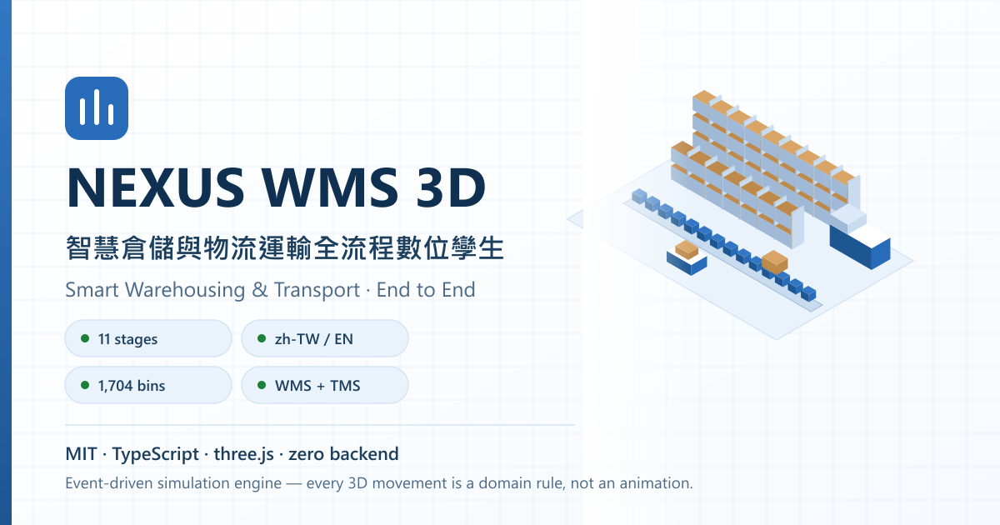
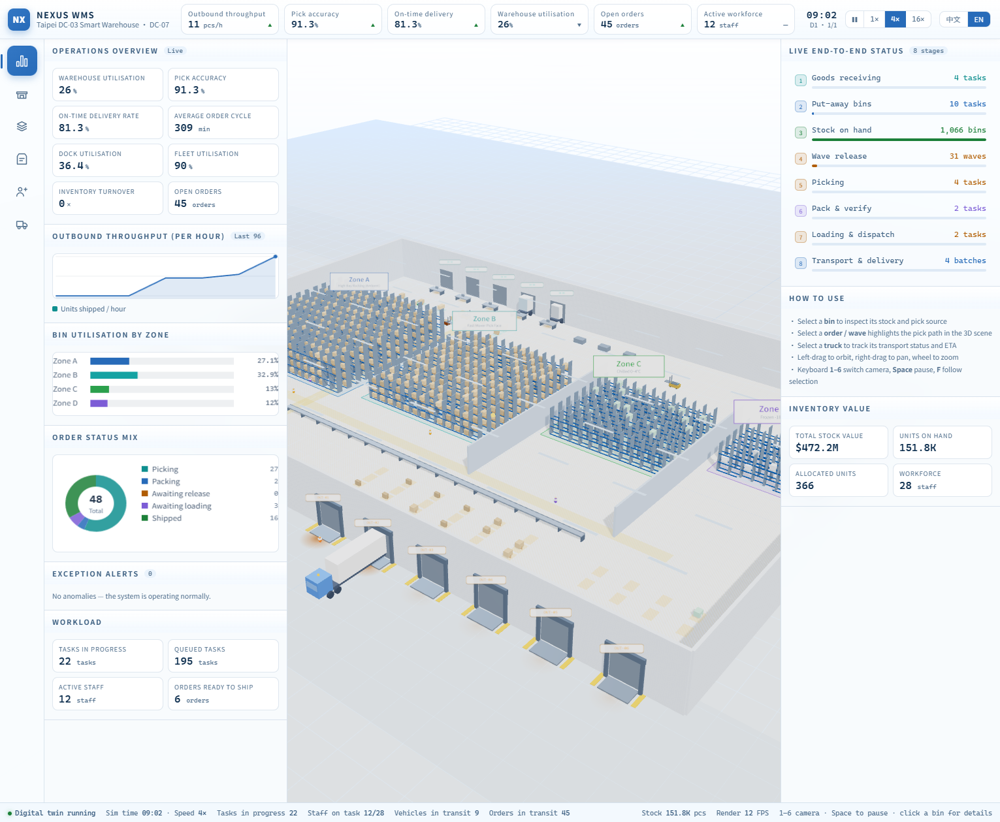
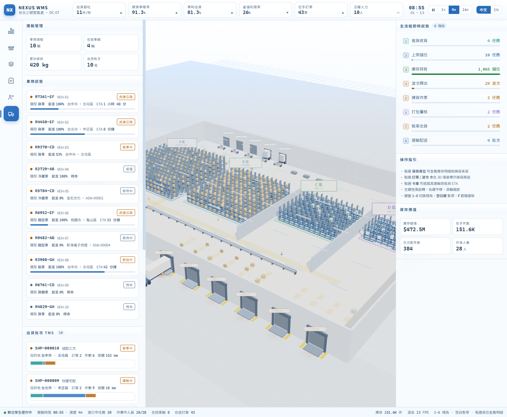

# NEXUS WMS 3D — 智慧倉儲與物流運輸全流程數位孿生

A production-grade **3D digital twin of a distribution centre**, covering the complete
warehouse-management and transport lifecycle — from advance shipping notice to customer
delivery and vehicle return.

Built with **Vite + TypeScript + three.js**. No external assets, no network calls, no
backend: every texture and every data set is generated procedurally at runtime, so the
build is fully self-contained and reproducible.

## Screenshots

| Operations overview (English) | Transport board (Traditional Chinese) |
|---|---|
|  |  |

The interface ships in **Traditional Chinese** and **English** — see
[Interface language](#interface-language).

---

## The full operational flow

The simulation runs a genuine event-driven WMS/TMS engine. Nothing is faked with a
scripted animation — every movement in the 3D scene is the visualised result of a
domain rule being executed.

| # | Stage | What actually happens |
|---|-------|-----------------------|
| 1 | **預到貨 (ASN)** | Suppliers send advance notices with ETA, PO, pallets and weight. |
| 2 | **進貨月台 (Inbound dock)** | A truck arrives at the gate, drives the yard route and parks at a free dock. Dock doors glow when occupied. |
| 3 | **收貨 (Receiving)** | Receivers book the receipt into inbound staging positions. Quantities that exceed a staging position are split across positions or diverted to the overflow buffer. |
| 4 | **上架 (Put-away)** | AGVs carry staged pallets to a bin chosen by temperature zone and ABC class. Oversized pallets are split across bins; capacity is re-checked at execution time. |
| 5 | **庫存 (Storage)** | 1,704 bins across 4 storage zones (high-bay, fast-mover flow, chilled, frozen) with per-bin weight/volume ledgers and lot-level traceability. |
| 6 | **波次 (Wave)** | Released orders are grouped into waves by priority and due date, assigned to pickers and a carrier. |
| 7 | **揀貨 (Picking)** | An S-shape (serpentine) pick-path optimiser orders bins by zone → row → bay → level, and the route is drawn in 3D. |
| 8 | **打包 (Packing)** | Packers consolidate lines into parcels at packing stations; order weight and volume are recomputed from what was actually picked. |
| 9 | **裝車 (Loading)** | Packed orders are consolidated into shipments, assigned to a vehicle and an outbound dock, and loaded parcel by parcel. |
| 10 | **運輸 (Transport)** | The truck leaves through the gate, runs a distance-based highway leg with ETA, fuel/CO₂ accrual and carrier speed factors, delivers, and returns to the yard. |
| 11 | **補貨 / 盤點 (Replenish / Cycle count)** | Fast-mover pick faces are replenished from reserve locations; periodic cycle counts are scheduled. |

Every stage is exposed as a live KPI, a work queue, and a clickable detail panel.

The table above lists the eleven domain stages end to end. The inspector's live
stage strip tracks the eight that have a continuously visible counter —
receiving, put-away, storage, wave, picking, packing, loading and transport —
while advance notice, dock arrival and cycle counting are visible on the
Inbound and Inventory boards.

---

## Features

### 3D scene
- Procedural warehouse: 38 racking rows, 1,704 bins, 4 storage zones, 11 dock doors,
  receiving/packing/QC/charging stations, conveyor spine, control-tower office, yard
  and road network.
- **Instanced rendering** for racking, pallets and cartons — the whole facility is a
  handful of draw calls.
- Directional sun with soft shadows, hemisphere fill, emissive dock beacons and
  ceiling light strips.
- Workers (28) and AGVs (10) are animated actors; trucks (10) drive real yard routes.
- Camera presets (`1`–`6`), smooth fly-to focus, orbit / pan / zoom.
- **Adaptive quality**: pixel ratio and shadows degrade automatically if the frame rate
  drops.

### Interaction
- Click any carton to identify its exact bin (instance → location mapping).
- Click any rack to resolve the bin analytically from the pointer ray.
- Click orders, waves or tasks to highlight their pick path in 3D.
- Hover anything for a contextual tooltip.
- Full keyboard support (`1`–`6` views, `Space` pause, `F` focus).

### Panels
Operations overview · Inbound · Inventory · Order fulfilment · Personnel & tasks ·
Transport — each with live charts rendered on canvas (sparkline, bars, donut,
route strip).

### Visual design
Light theme (white + light blue):

- The interface background is white / very light blue (`--bg-0: #ffffff`,
  `--bg-1: #f6fafe`); the single accent colour is the light blue
  `--accent: #276bb9`. Semantic colours are reserved for state
  (green = nominal, amber = warning, red = exception).
- The 3D scene follows the same direction: the sky is a white-to-pale-blue
  gradient, the fog is `#dcecff`, rack beams use the accent blue, and walls
  and floors are a light grey-blue with low-saturation blocks marking the
  docks and walkways.
- Charts are drawn directly on a canvas, so their palette is synchronised with
  the theme tokens (no leftover dark colours to break contrast).
- **Contrast audit** — `scripts/contrast-audit.mjs` reads the design tokens
  straight out of `main.css` and checks 17 foreground/background pairs against
  WCAG 2.1 AA (4.5:1 for body text, 3:1 for large text and non-text elements).
  The first light-theme pass failed 12 of them; the accent and semantic
  colours were deepened until every pair passed, so a future palette tweak
  cannot silently degrade into an unreadable UI.
- Honours `prefers-reduced-motion`, `prefers-contrast: more` and
  `focus-visible` keyboard focus styles.

---

## Interface language

The interface ships in **Traditional Chinese (`zh-TW`, the default)** and
**English (`en`)**. Switch between them with the `中文 / EN` control in the top
bar; the choice is remembered in `localStorage` and applied before the scene is
built, so a reload comes back in the same language.

How it works:

| Piece | Where | What it does |
|-------|-------|--------------|
| Runtime | `src/core/i18n.ts` | Language state, `t()`, tagged templates, lazy domain messages, label tables, locale-aware numbers |
| Dictionary | `src/core/dictionary.ts` | The English translations (317 keys) |
| Scanner | `scripts/i18n-scan.mjs` | AST-based scan of `src/` for Chinese strings |
| Gate | `scripts/i18n-check.mjs` | Verifies the dictionary against the source |

**Keys are the Chinese source strings.** A call site reads naturally in the
primary language, and the dictionary can be validated mechanically:

```ts
t('揀貨準確率')          // → '揀貨準確率' | 'Pick accuracy'
t('裝車 {0}', orderId)   // → '裝車 SO-1'  | 'Load SO-1'
t`模擬時間 ${clock}`      // → '模擬時間 08:30' | 'Simulated time 08:30'
```

Three rules keep it honest:

1. **Nothing user-visible is hard-coded.** Every string goes through `t()`,
   a tagged template, or a `labelTable({ … })`. The i18n gate fails the build
   if a Chinese literal appears unwrapped.
2. **Domain messages are lazy.** A task label or alert is stored as a
   descriptor (`msg()`) and rendered on demand, so an event created hours ago
   still appears in the language the operator is currently using.
3. **Business records are bilingual.** The catalogue (SKUs, categories,
   suppliers, customers, carriers), the zones and the order channels each carry
   an English variant next to the Chinese source; the interface picks the
   right one at render time.

`npm run i18n:check` reports missing translations, unused ones, translations
that still contain Chinese, and placeholder mismatches.

---

## Running it

```bash
npm install
npm run dev        # dev server on http://127.0.0.1:5173
npm run build      # typecheck + production build into dist/
npm run preview    # serve the production build on http://127.0.0.1:4173
npm test           # vitest suite (69 tests)
npm run typecheck  # tsc --noEmit
npm run audit:contrast  # WCAG 2.1 contrast audit (light theme)
npm run i18n:check # dictionary completeness + no untranslated strings
npm run i18n:keys  # print every translation key and where it is used
npm run og         # regenerate public/og.png (needs: npm i -D sharp)
npm run predeploy    # release gate (types → tests → i18n → contrast → build →
                     # dist integrity → bundle budget)
```

## Project layout

```
src/
  core/        rng.ts (deterministic PRNG) · events.ts (typed emitter)
               i18n.ts (language runtime) · dictionary.ts (English strings)
  domain/      types.ts · layout.ts · catalog.ts · inventory.ts
               picking.ts (wave planner + path optimiser) · resources.ts
               labels.ts (bilingual record helpers) · engine.ts (simulation core)
  core/__tests__/  i18n.test.ts
  domain/__tests__/  engine.test.ts · invariants.test.ts
  three/       scene.ts (renderer/camera/picking) · warehouse.ts (geometry)
               actors.ts (trucks/workers/AGVs) · overlays.ts (paths/markers)
               materials.ts · textures.ts (procedural canvas textures)
  ui/          app.ts (shell + interaction) · sections.ts (panels)
               inspector.ts (detail panel) · charts.ts · dom.ts
scripts/      contrast-audit.mjs (WCAG 2.1 palette audit)
              i18n-scan.mjs (AST scanner) · i18n-check.mjs (dictionary gate)
              predeploy.mjs (release gate) · generate-og.mjs (share card)
public/      og.png (Open Graph / Twitter card, 1200x630)
docs/        architecture.md · screenshots/
```

The `domain/` layer is pure TypeScript with **no DOM dependency**, which is why the
simulation can be unit-tested directly in Node. `core/i18n.ts` follows the same
rule — it touches `localStorage` only behind a guard — so the domain can produce
translated messages without depending on the UI.

---

## Engineering notes

- **Determinism** — every generated artefact (SKU catalogue, layout, orders, ASN
  schedule, fleet movements) derives from a single seeded PRNG, so the same seed always
  produces the same world. This makes the test suite meaningful.
- **Inventory integrity** — stock is tracked per lot with an immutable movement trail.
  Tests assert quantity conservation across receipts, transfers, picks and shipments, and
  that the per-location weight/volume ledger always equals the lots it holds.
- **Reservation integrity** — reservations follow the goods: moving stock releases the
  reservation proportionally, a lot can never hold more reserved than it has on hand,
  and replenishment never forward-picks stock promised to an open order.
- **Capacity enforcement** — bin capacity is validated when a job is *planned* and again
  when it *executes*, because several jobs may target the same bin before any of them
  completes. Over-sized receipts are split across bins rather than silently overfilling.
- **Fleet exclusivity** — a truck can only hold one active shipment; docks are released
  when a truck departs.
- **Performance** — no per-frame allocations in the hot path, instanced geometry,
  emissive materials instead of point lights (a forward renderer pays per light per
  fragment), throttled DOM updates and scroll-preserving panel refresh.
- **Robustness** — WebGL support is detected before initialisation and a readable
  failure card is shown if the GPU stack is unavailable; all engine handlers are
  guarded, so one failing task can never halt the simulation loop.
- **Release gate** — `npm run predeploy` is the single command that has to pass before
  the site is published: type check → unit + invariant tests → i18n dictionary audit →
  WCAG contrast audit → production build → `dist/` integrity (the root must contain
  `index.html`, every asset referenced by it must exist, and no stray or stale files may
  be shipped) → bundle budget (total ≤ 1.5 MB, largest asset ≤ 700 KB). It exits
  non-zero on the first failure and is wired into CI.

## Testing

```
npm test
```

69 tests in four suites:

- `engine.test.ts` (25) — RNG determinism, layout integrity, inventory conservation and
  reservations, pick-path optimisation, wave planning, engine bootstrap, the full order
  lifecycle, capacity limits, fleet exclusivity and dock release.
- `invariants.test.ts` (17) — cross-entity invariants that only break when two parts of the
  system disagree: the per-location weight/volume ledger against the lots it holds,
  reservations never exceeding stock on hand, shipment weight/volume/parcels against the
  orders inside them, one truck per dock, active tasks attached to busy assignees, wave
  references, clock monotonicity and KPI ranges.
- `stress.test.ts` (10) — the same load-bearing properties re-checked across **12 different
  seeds**. A single seed only exercises one path through the random number generator, so a
  defect that needs a particular draw — an oversized pallet that must be split, a wave that
  overflows the pick capacity, a truck arriving while every dock is busy — would slip past a
  one-seed suite. The suite also asserts that the seeds genuinely diverge (12 distinct
  outcome profiles), so it cannot silently degrade into testing one branch twelve times.
- `i18n.test.ts` (17) — the language runtime (locale switching, placeholders, tagged
  templates, lazy domain messages, label tables) and dictionary integrity (every key
  translated, no stale entries, no Chinese left in a translation, placeholders in sync, no
  unwrapped Chinese literals anywhere in `src/`).

The invariant suite found two genuine defects during development, both fixed:

1. **Reservation leak** — moving stock out of a bin (replenishment) did not release the
   reservation held against it, so a lot could end up holding more reserved than it had on
   hand, understating availability. Reservations now follow the goods, and replenishment
   never forward-picks stock that is already promised to an open order.
2. **Wrong unit conversion on pick** — the engine matched pick allocations by bin only, so
   a bin holding several SKUs could have another SKU's allocation committed as well, and
   the ledger was converted with the wrong SKU's unit weight. Allocations now carry their
   SKU, are matched on SKU *and* bin, and every weight/volume conversion uses the lot's
   own SKU.

Two KPI models were also corrected: pick accuracy is now the share of correctly handled
pick lines (it used to decay multiplicatively with the number of lines, which made the
metric meaningless), and the customer promise windows are calibrated against the
facility's achievable cycle time so on-time delivery is a real performance signal rather
than a structural impossibility.

## Browser support

Requires WebGL 2 and ES2022 — Chrome/Edge 113+, Safari 16.4+, Firefox 115+.
Responsive down to tablet width (panels collapse into drawers).

---

## Contributing

Issues and pull requests are welcome — see [CONTRIBUTING.md](CONTRIBUTING.md).
The short version: run `npm run predeploy` before you open the PR, and check
your change in **both** interface languages.

- Issues: <https://github.com/Kylelau339/nexus-wms-3d/issues>
- Pull requests: <https://github.com/Kylelau339/nexus-wms-3d/pulls>
- Discussions and questions: <https://github.com/Kylelau339/nexus-wms-3d/discussions>

Everything in this repository is generated or hand-written — there are no
third-party assets, fonts or datasets, so there is nothing to license and
nothing to clean up before shipping a fork.

### Deploying your own copy

The build is fully static, so any static host works — no server, no API keys,
no environment variables. Point it at `dist/` after `npm run build`.

`npm run build` emits relative asset paths (`./assets/…`), so the output works
from a domain root **and** from a project sub-path such as
`github.io/nexus-wms-3d/` without any configuration change.

The repository also ships a GitHub Actions workflow
(`.github/workflows/pages.yml`) that publishes `dist/` to GitHub Pages on every
push to `main`. To use it, flip **Settings → Pages → Source** to *GitHub
Actions* once; every later push redeploys automatically.

## License

[MIT](LICENSE) © 2026 Kyle. Every asset, dataset and texture in this project is
generated procedurally at runtime — there are no third-party assets, fonts or
data files to license.

